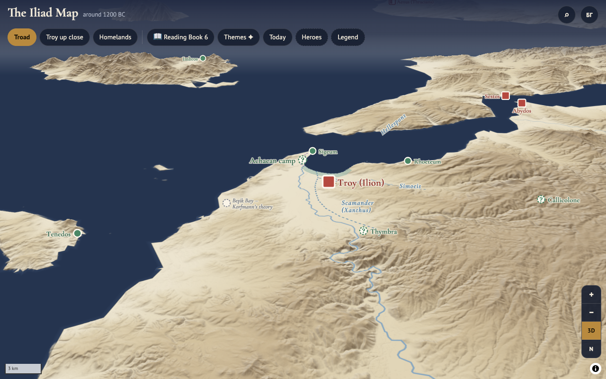
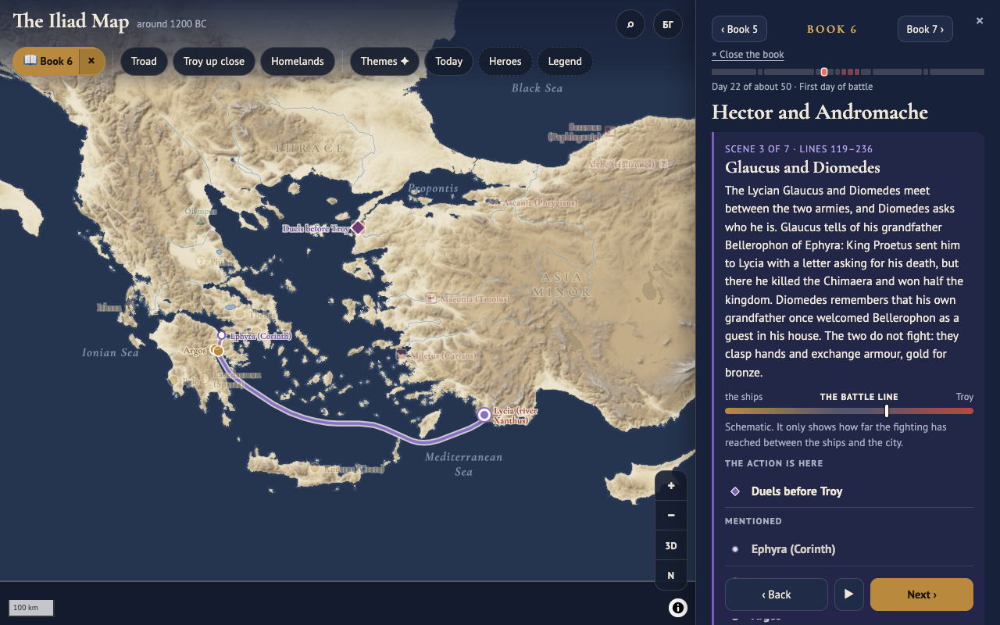
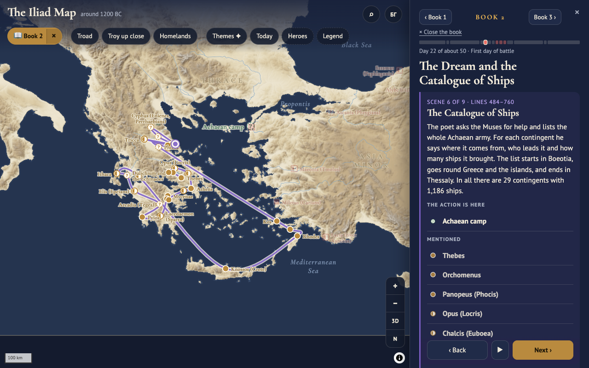
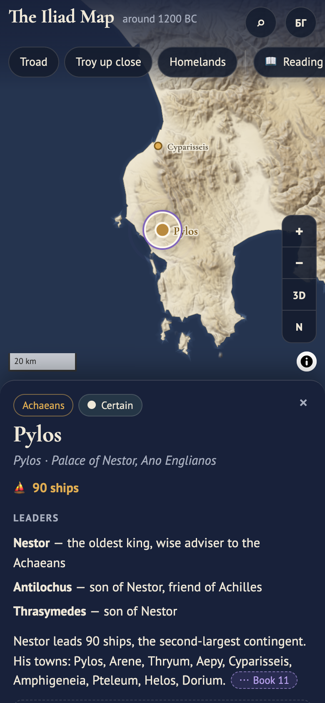

# The Iliad Map

An interactive map for people who are reading Homer's *Iliad* right now.

**Open the map: https://devladinci.github.io/iliad-map/**

It answers three questions: where am I in the poem, who are these people, and where did it happen.



| Reader mode, Book 6 | The Catalogue of Ships | On a phone |
|---|---|---|
|  |  |  |

## What it does

- **Follows your reading.** Tell it which book you are on. Each book is split into scenes. Step through them and the map moves with the story.
- **Keeps the ending to itself.** Anything that happens after your bookmark stays hidden until you get there.
- **Shows real terrain.** Mount Ida, the plain of Troy and the ridges around it are drawn from elevation data. There is a 3D view.
- **Is honest about what is known.** Every place has a certainty level. Disputed locations are marked, and the other candidates are shown.
- **Shows the coast of about 1200 BC**, when Troy stood near a bay, next to the coast of today.
- **Has themes:** the realms of the kings, routes of heroes and gods, archaeology, the collapse around 1200 BC, trade, sanctuaries, Linear B, Hittite names and more.
- **Knows the people.** Cards for the main heroes, seven family trees, and the gods by the side they take.
- **Shows the shape of the war.** A strip places each scene in the fifty-odd days of the poem, and a schematic battle line shows how far the fighting has reached.
- **Links then to now.** A slider fades the old coast into today's, and a "Today" layer adds modern towns and borders.
- **Works offline** once it has been opened, and can be added to a phone's home screen.
- **Speaks Bulgarian and English.** Search works in both at once.

## Run it

You need Node 22 or newer.

```bash
npm install
```

```bash
npm run dev
```

Other commands:

| Command | What it does |
|---|---|
| `npm run check` | Checks the content: ids, both languages, spoiler tags, scenes |
| `npm run typecheck` | Checks the code |
| `npm run build` | Runs both checks and builds the site into `dist/` |
| `node scripts/fetch-terrain.mjs` | Downloads the elevation tiles again |
| `npm run smoke` | Walks through every scene in both languages and fails on any page error (needs `npm run dev` running and Chrome installed) |
| `node scripts/shot.mjs out.png "#l=en&b=6&s=3"` | Takes a screenshot of a given state, for checking the look by eye |

## How it is organised

```
src/            the engine: map, reader mode, panels (TypeScript, MapLibre, Preact)
content/iliad/  the Iliad itself: places, events, routes, themes, scenes (data only)
  text/bg, en   the words, one folder per language
public/geo/     coastline, rivers, the coast of 1200 BC, realms, the plan of Troy
public/terrain/ elevation tiles
scripts/        content check, terrain download, screenshots
```

The engine knows nothing about the *Iliad*. Another work would be a second folder next to `content/iliad/`.

To change a text, a location or a certainty level, edit the JSON in `content/iliad/`. The rules are in [content/README.md](content/README.md).

## Adding a language

1. Copy `content/iliad/text/en/` to a new folder, for example `text/de/`.
2. Translate the values. Keep the keys and the `{{N|…}}` spoiler tags.
3. Add the interface words in `src/i18n.ts`, and the language code in `src/types.ts` and in `firstLang` in `src/state.ts`.
4. Run `npm run check`.

## Honesty rules

- Positions of battles, the camp and routes are schematic. Homer names the points, not the exact spot. The map says so on each of them.
- The realms are zones drawn around the towns Homer lists. They are not historical borders.
- The ancient coastline follows published reconstructions. Some parts are much less certain than others, and each note says which.
- Summaries are in our own words. No published translation of the poem is quoted.
- [content/REVIEW.md](content/REVIEW.md) lists statements that still need a second look.

Found a mistake? Please open an issue and name your source.

## Credits and licences

- Code: MIT, see [LICENSE](LICENSE).
- Texts and place data: CC BY 4.0, see [LICENSE-content.md](LICENSE-content.md).
- The coastline, the elevation data, the gazetteer of ancient places, the rivers and the research behind the old coastline all come from others. Every source is named in [ATTRIBUTION.md](ATTRIBUTION.md), and the map itself shows the credits under the ⓘ button and in the legend.
